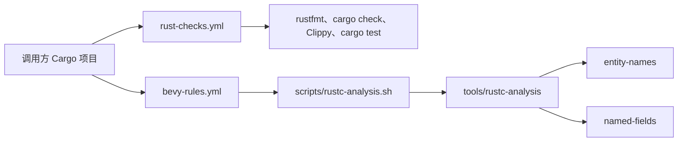
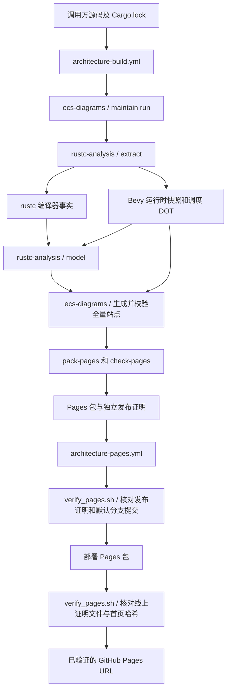

# 仓库维护概览

bevy-cicd 为调用方的 Bevy 项目提供 Rust 检查、编译器规则、ECS 架构图生成和 GitHub Pages 发布。接入示例和 Cargo 配置见 [工作流接入](workflows.md)。

## `.github/workflows/`

| 工作流 | 作用 |
| --- | --- |
| [`rust-checks.yml`](../.github/workflows/rust-checks.yml) | 按调用方配置的 Rust 工具链运行格式检查、`cargo check`、Clippy 和测试。指定 `features` 时额外检查该配置。 |
| [`bevy-rules.yml`](../.github/workflows/bevy-rules.yml) | 用本仓库锁定的 nightly 编译调用方指定的包，分别执行 `entity-names` 和 `named-fields`。 |
| [`architecture-build.yml`](../.github/workflows/architecture-build.yml) | 提取编译器事实和运行时调度，生成并校验 ECS 架构站点，上传 Pages 包、发布证明和构建证据。 |
| [`architecture-pages.yml`](../.github/workflows/architecture-pages.yml) | 核对同一次运行的发布证明，只部署默认分支当前提交对应的产物，部署后通过 HTTP 验证内容。 |
| [`test-bevy-rules.yml`](../.github/workflows/test-bevy-rules.yml) | 以 [`examples/bevy-rules`](../examples/bevy-rules) 调用 Rust 检查和 Bevy 规则，运行工具回归，并用 `violations` feature 确认两条规则会报错。 |
| [`test-pages.yml`](../.github/workflows/test-pages.yml) | 检查 Bash 校验脚本的语法，运行 ECS 部署验证的 Node 回归，并验证上传的 Pages 包保留 `.nojekyll`。 |

## `scripts/`

| 入口 | 作用 |
| --- | --- |
| [`rustc-analysis.sh`](../scripts/rustc-analysis.sh) | `prepare` 和 `prepare-architecture` 构建分析工具并预取锁定依赖。`check`、`extract` 和 `model` 转发给分析器。`test` 执行分析器及两条规则的回归测试。 |
| [`verify_pages.sh`](../scripts/verify_pages.sh) | `validate` 用 `jq` 检查发布证明中的提交和首页 SHA-256。`current` 通过 `gh` 查询默认分支当前提交。`verify` 用 `curl` 取回公开站点的证明文件和首页并核对内容。 |

## `tools/`

| 工具 | 作用 |
| --- | --- |
| [`rustc-analysis`](../tools/rustc-analysis) | `contract` 定义编译器事实及报告契约，`compiler` 从 rustc 提取事实并应用规则，`runner` 编排 Cargo、读取运行时调度并装配语义模型。 |
| [`check-entity-names`](../tools/check-entity-names) | 实体命名规则的独立 CLI 和回归测试，验证生产代码创建实体时提供非空 `Name`。 |
| [`check-named-fields`](../tools/check-named-fields) | 命名字段规则的独立 CLI 和回归测试，检查项目代码中的单字段元组结构体。 |
| [`bevy-schedule-export`](../tools/bevy-schedule-export) | 共享启动器调用的 Rust 库，在插件就绪后导出主应用和子应用的调度快照与 DOT。 |
| [`ecs-diagrams`](../tools/ecs-diagrams) | Node 工具包，负责架构站点的生成、校验、打包和本地预览。调度图由 Graphviz 渲染，对象关系图由 Mermaid 渲染。 |

## ECS 架构站点的数据流

构建和校验的本地复现步骤见 [ECS 架构图维护](ecs-diagrams/maintenance.md)。调度图、对象关系图和证据的读法见 [ECS 架构图参考](ecs-diagrams/README.md)。
